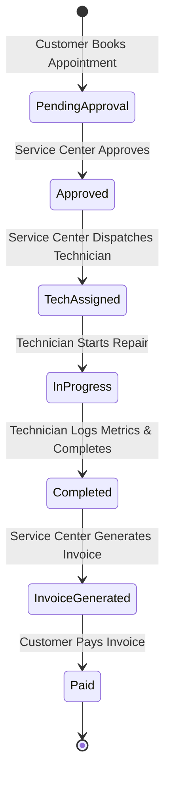
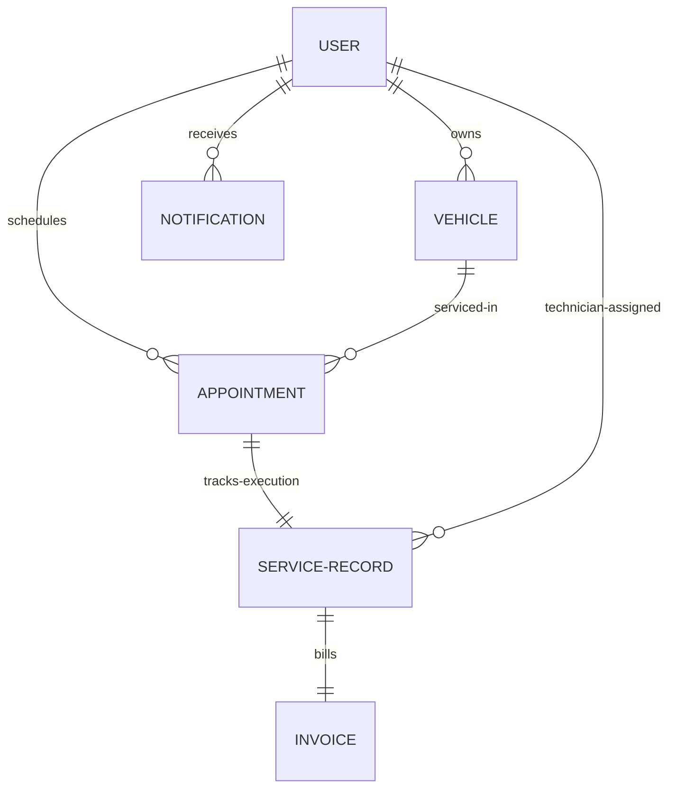

# 🚗 AutoCare: Vehicle Service Management Platform (VSM)

AutoCare is a comprehensive, full-stack MERN (MongoDB, Express.js, React, Node.js) web application designed to digitize and streamline vehicle service center operations. It provides a robust, roles-based platform for vehicle owners (customers), service center dispatchers, automotive technicians, and system administrators to manage the end-to-end lifecycle of vehicle maintenance, from appointment booking to repair execution, invoicing, and final payment.

---

## 🏗️ Technical Stack

The application is architected as a decoupled client-server system with modern frameworks and robust data-handling:

| Layer | Technology / Library | Description |
| :--- | :--- | :--- |
| **Frontend** | React (Vite) | Fast, responsive single-page application framework. |
| **State Management** | Redux Toolkit | Centralized state management for authentication, appointments, records, and invoices. |
| **Styling** | Tailwind CSS & Vanilla CSS | Modern, fluid interface utilizing glassmorphism, responsive grids, and premium aesthetics. |
| **Feedback System** | React Hot Toast | High-end visual alerts and notifications for state updates. |
| **Backend API** | Node.js + Express.js | RESTful API backend handling business logic, authentication, and database routing. |
| **Database** | MongoDB + Mongoose | Document-oriented NoSQL database with Mongoose ODM for schemas and relationships. |
| **Authentication** | JWT (JSON Web Tokens) | Stateless session authentication via Bearer tokens stored in browser localStorage. |

---

## 👥 System Roles & Portals

The platform enforces Role-Based Access Control (RBAC) to ensure that users only access functionality relevant to their operations:

### 1. 👤 Customer (Fleet / Vehicle Owner)
*   **Default Test Account**: `customer@test.com` (or `customer@vsm.com`) / Password: `Test@123` (or `CustomerPassword123!`)
*   **Key Responsibilities**:
    *   Registering and managing personal vehicles (Make, Model, Year, License Plate).
    *   Booking new service appointments (selecting vehicle, choosing service type, date, time, and entering notes).
    *   Tracking current vehicle service progress in real-time.
    *   Viewing generated invoices and paying them securely via the Payment Hub.

### 2. 🏢 Service Center (Dispatcher / Manager)
*   **Default Test Account**: `servicecenter@test.com` (or `service@vsm.com`) / Password: `Test@123` (or `ServicePassword123!`)
*   **Key Responsibilities**:
    *   Reviewing pending service requests in the Master Appointment Queue.
    *   Approving or rejecting customer appointments.
    *   Assigning/dispatching specific Technicians to approved jobs (which instantiates the official `ServiceRecord`).
    *   Monitoring active repairs ("Live Repair Monitors").
    *   Generating invoices upon service completion and tracking overall service center metrics.

### 3. 🔧 Technician (Mechanic / Executor)
*   **Default Test Account**: `tech@test.com` (or `mechanic@vsm.com`) / Password: `Test@123` (or `MechanicPassword123!`)
*   **Key Responsibilities**:
    *   Viewing assigned jobs on the Technician Workbench ("My Assigned Tasks").
    *   Updating service records when starting repairs (moves status to "Repair In Progress").
    *   Logging final execution metrics (labor hours, parts used, and prices).
    *   Completing the repair, automatically triggering invoice readiness.

### 4. 👑 Admin (System Overlord)
*   **Default Test Account**: `admin@vsm.com` / Password: `AdminPassword123!`
*   **Key Responsibilities**:
    *   Managing platform user accounts (Admin, Service Center, Technician, Customer).
    *   Provisioning new technicians and setting center capacities.
    *   Accessing high-level analytics, financial rollups, and activity metrics.
    *   Enforcing account status (active/inactive) using a Soft-Delete design.

---

## 🔄 Strict Service Request Lifecycle

To ensure transaction and operations integrity, every service request transitions linearly through a strict state machine:



1.  **Pending Approval**: Customer requests service. The appointment goes into the queue.
2.  **Approved**: Service Center reviews details and approves.
3.  **Technician Assigned**: Service Center selects a technician from the roster and dispatches them. This creates a corresponding `ServiceRecord`.
4.  **Repair in Progress**: The assigned technician changes the status to start work.
5.  **Completed**: The technician finishes work, logs actual labor hours, lists parts used, and marks the service complete.
6.  **Invoice Generated**: The system calculates totals based on labor and parts. Service Center reviews and locks the invoice.
7.  **Paid**: Customer pays the invoice. The transaction settles.

---

## 📊 Data Models & Schema Registry

The database is built on MongoDB using Mongoose, featuring cross-document references:



### 1. User Schema (`User`)
*   Contains core credentials: `name`, `email`, `password` (hashed), `role` (Admin, Service Center, Technician, Customer), `phone`, `address`, and `isActive` (boolean for Soft Delete architecture).

### 2. Vehicle Schema (`Vehicle`)
*   Tracks assets: `make`, `model`, `year`, `licensePlate`, and `user` (Mongoose ObjectId ref to `User`).

### 3. Appointment Schema (`Appointment`)
*   Controls the initial booking: `user`, `vehicle`, `date`, `time`, `serviceType` (e.g. Oil Change, Repair, Inspection), `notes`, and `status` (Enum: `Pending Approval`, `Approved`, `Technician Assigned`, `Repair In Progress`, `Completed`).

### 4. Service Record Schema (`ServiceRecord`)
*   Bridges work execution to billing: `vehicle`, `appointment`, `technician` (ref to `User`), `serviceType`, `description`, `status` (Enum: `Technician Assigned`, `Repair In Progress`, `Completed`), `laborHours` (Number), `partsUsed` (Array of `{ name, quantity, price }`), and `completedAt` (Date).

### 5. Invoice Schema (`Invoice`)
*   Manages financial entries: `serviceRecord` (Unique Ref to `ServiceRecord` to enforce a 1:1 constraint), `vehicle` (ref to `Vehicle`), `user` (ref to Customer `User`), `totalAmount` (calculated value), `paymentStatus` (Enum: `Pending`, `Paid`), and `paymentDate`.

### 6. Notification Schema (`Notification`)
*   Tracks client/staff alerts: `user` (ref to recipient), `title`, `message`, `type` (Info/Alert), and `isRead` (boolean).

---

## 💰 Invoice Cost Calculation Logic

Invoices are dynamically calculated in the backend based on technician input:

$$\text{Labor Cost} = \text{Labor Hours} \times \$100/\text{hr}$$
$$\text{Parts Cost} = \sum (\text{Part Price} \times \text{Part Quantity})$$
$$\text{Subtotal} = \text{Labor Cost} + \text{Parts Cost}$$
$$\text{Tax} = \text{Subtotal} \times 10\%$$
$$\text{Total Invoice Amount} = \text{Subtotal} + \text{Tax}$$

---

## 📂 Repository Directory Layout

The codebase separates concerns between frontend, backend, documentation, and seeding scripts:

```text
/d:/Vehicle Service Management/
├── client/                     # Frontend (React + Vite)
│   ├── src/
│   │   ├── components/         # Reusable UI library (Card, Table, Loader)
│   │   ├── pages/              # Portal Dashboards and View Pages
│   │   ├── redux/              # Redux slices and store configuration
│   │   ├── services/           # Axios API connectors
│   │   └── utils/              # State constants and helper functions
│   └── tailwind.config.js      # CSS configuration
├── server/                     # Backend (Node.js + Express API)
│   ├── config/                 # DB connectivity config
│   ├── controllers/            # Business handlers (Auth, User, Admin, Invoice, Record)
│   ├── middleware/             # RBAC authentication and global error handlers
│   ├── models/                 # Mongoose schema definitions
│   ├── routes/                 # Express API endpoints
│   ├── seeder/                 # DB Seeding utilities
│   └── server.js               # Entry point
├── docs/                       # Project Documentation & Verification Guides
│   ├── CHANGES_SUMMARY.md      # Summary of updates
│   ├── INVOICE_FIX_GUIDE.md    # Step-by-step invoice system documentation
│   └── QUICK_TEST_GUIDE.md     # Quick testing manual
└── README.md                   # Getting Started Guide
```

---

## 🔧 Recent Critical Enhancements

The platform has recently undergone a major update to fix bugs in the billing pipeline:

1.  **State Synchronization**: Configured `serviceRecordController.js` to update both the `ServiceRecord` and corresponding `Appointment` status synchronously when the technician marks a job as "Completed".
2.  **Stringified ObjectId Comparisons**: Solved React state-matching bugs in `ServiceCenterDashboard.jsx` by converting Mongoose ObjectIds into strings (`String(inv.serviceRecord) === String(r._id)`) before checking if an invoice had already been generated.
3.  **Strict Status Validation**: Configured the frontend and backend to block invoice generation unless a repair record status is explicitly set to `"Completed"` (preventing premature billing).
4.  **Robust Math Operations**: Added defensive checks to handle cases where a technician logs a job without any parts, preventing array iteration errors.
5.  **Verbose Logging**: Inserted diagnostic logging points (prefixed with `🔷` and `✅`) throughout the execution stack, simplifying future updates.
