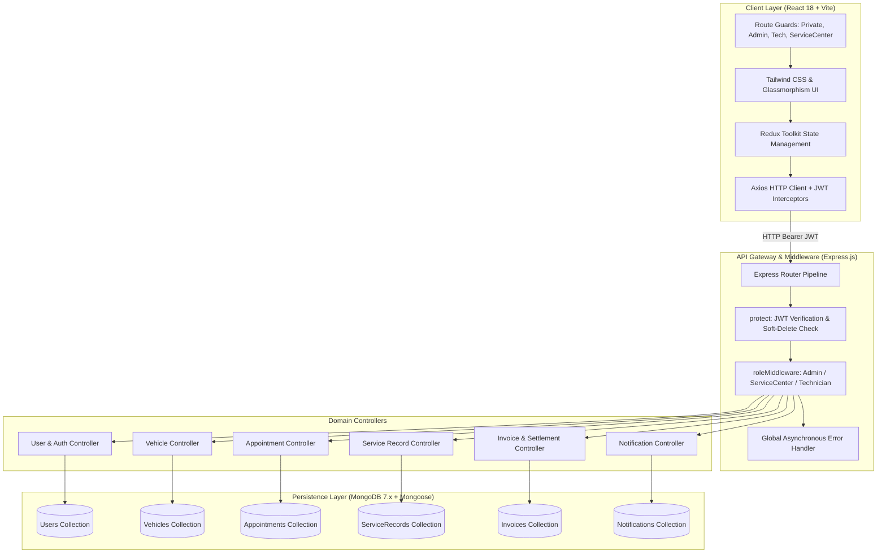
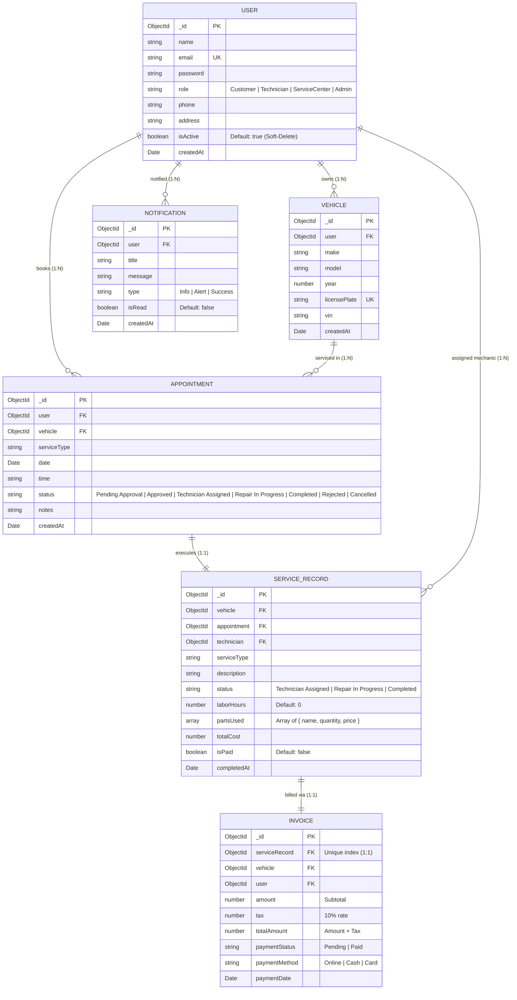
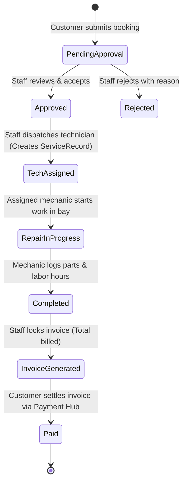

# System Architecture & Technical Specifications — AutoCare 🚗⚙️

AutoCare is an enterprise-grade Vehicle Service Management Platform engineered using the MERN stack (MongoDB, Express.js, React, Node.js). This document details the end-to-end system architecture, component hierarchies, database entity relationships, security implementations, state machines, and concurrency patterns.

---

## 1. High-Level System Architecture

The platform operates as a decoupled single-page application (SPA) communicating over a RESTful JSON API with an asynchronous Express.js backend.



---

## 2. Frontend Architecture (React + Vite)

The frontend single-page application is built on **React 18** and packaged via **Vite 4**, ensuring sub-second hot-module replacement and optimized tree-shaken production bundles.

### 2.1 State Management (Redux Toolkit)
Centralized state is maintained through Redux Toolkit slices with predictable unidirectional data flow:
* `authSlice`: Current authenticated user profile, token persistence in `localStorage`, and role-based hydration.
* `appointmentSlice`: Global and user-scoped appointment queues, booking state, and approval/rejection flags.
* `serviceRecordSlice`: Technician job workbench, bay status transitions, parts inventory, and labor metrics.
* `invoiceSlice`: Billed invoices, customer payment status, and settled receipts.

### 2.2 Client-Side Route Guards
Hierarchical route guarding prevents unauthorized layout access:
* `PrivateRoute`: Verifies active session token; redirects unauthenticated visitors to `/login`.
* `AdminRoute`: Verifies `user.role === 'Admin'`.
* `ServiceCenterRoute`: Verifies `user.role === 'ServiceCenter'` or `'Admin'`.
* `TechnicianRoute`: Verifies `user.role === 'Technician'` or `'Admin'`.

### 2.3 Component Hierarchy & Layout Structure
* `Layout.jsx`: Protected shell featuring a responsive navigation bar, role-aware sidebar, notification badge counter, and dynamic breadcrumbs.
* `PublicLayout.jsx`: Informational shell for public pages (`Documentation`, `Privacy`, `Home`).
* Role Dashboards:
  * `CustomerDashboard.jsx`: Vehicle fleet management, quick service booking, live progress tracker, and payment shortcuts.
  * `ServiceCenterDashboard.jsx`: Appointment triage queue, technician assignment dispatch board, live bay monitors, and invoice creation engine.
  * `TechnicianDashboard.jsx`: Technician Workbench with assigned repair tickets, parts consumption loggers, labor hour trackers, and repair completion triggers.
  * `AdminDashboard.jsx`: System overview, user provisioning, technician onboarding, and account status toggles (soft-delete).

---

## 3. Backend Architecture (Express.js + Node.js)

The server utilizes modern ES Modules (`type: "module"`) running on Node.js with an Express.js middleware pipeline.

### 3.1 Middleware Pipeline
1. **Body Parsing & CORS:** `express.json()` and `cors()` enable structured cross-origin JSON communication.
2. **Authentication Middleware (`protect`):**
   * Decodes `Authorization: Bearer <token>` using `process.env.JWT_SECRET`.
   * Queries MongoDB for the user record (excluding password hash).
   * **Soft-Delete Enforcement:** Immediately terminates requests with `401 Unauthorized` if `user.isActive === false`.
3. **Role Authorization Middleware (`admin`, `serviceCenter`, `technician`):**
   * Verifies `req.user.role` matches the required permission profile.
4. **Global Asynchronous Error Handler:**
   * Standardizes error responses into `{ message: string, stack?: string }` and assigns HTTP status codes defensively.

---

## 4. Database Models & Entity Relationships (MongoDB / Mongoose)

The persistence layer is modeled using Mongoose 7.5 schemas enforcing referential integrity, indexes, and schema-level validation:



---

## 5. Security Engineering & Authorization Gates

### 5.1 Insecure Direct Object Reference (IDOR) Guards
* **Vehicle Booking Ownership Validation:**
  In `appointmentController.js`, customers can only book appointments for vehicles they verifiably own. The controller verifies `vehicle.user.toString() === req.user._id.toString()`. Any attempt to pass a foreign vehicle ID is rejected with `403 Forbidden`.
* **Invoice Payment Authorization:**
  In `invoiceController.js`, payment requests verify that the authenticated customer is the verified owner of the invoice or the associated vehicle. Foreign customer payment attempts receive `403 Forbidden`.

### 5.2 Broken Object-Level Authorization (BOLA) Guards
* **Technician Task Isolation:**
  In `serviceRecordController.js`, technicians can only view and update repair records explicitly assigned to them (`record.technician.toString() === req.user._id.toString()`). Unauthorized status modifications are rejected with `403 Forbidden`.

### 5.3 Mongoose 7 Pre-Save Hook Safety
In Mongoose 7+, asynchronous `pre('save')` hooks must return promises without calling deprecated `next()`. The `userModel.js` hook was updated to:
```javascript
userSchema.pre('save', async function () {
  if (!this.isModified('password')) {
    return;
  }
  const salt = await bcrypt.genSalt(10);
  this.password = await bcrypt.hash(this.password, salt);
});
```
This guarantees that password hashing is idempotent, does not re-hash already hashed passwords on profile or status updates, and prevents unhandled promise rejections.

---

## 6. Business Lifecycle & State Machine

Every vehicle service request follows a strict linear state progression:



### 6.1 Dynamic Bill Calculation Engine
When a repair is completed, the billing engine computes:
$$\text{Labor Cost} = \text{Labor Hours} \times \$100.00/\text{hr}$$
$$\text{Parts Total} = \sum_{i=1}^{n} (\text{Part Price}_i \times \text{Part Quantity}_i)$$
$$\text{Subtotal} = \text{Labor Cost} + \text{Parts Total}$$
$$\text{Tax (10\%)} = \text{Subtotal} \times 0.10$$
$$\text{Total Invoice Amount} = \text{Subtotal} + \text{Tax}$$

### 6.2 Payment Concurrency & Compensating Rollback
To prevent race conditions, double payments, and state divergence on standalone MongoDB:
1. **Atomic Conditional Lock:**
   ```javascript
   const updatedInvoice = await Invoice.findOneAndUpdate(
     { _id: invoice._id, paymentStatus: 'Pending' },
     { $set: { paymentStatus: 'Paid', paymentDate: new Date(), paymentMethod } },
     { new: true }
   );
   ```
   If a competing request settles the invoice first, `matchedCount` is 0 and the request is immediately rejected with `400 Bad Request`.
2. **Compensating Rollback:**
   If synchronizing `ServiceRecord.isPaid = true` fails, a compensating rollback immediately reverts the invoice:
   ```javascript
   await Invoice.updateOne(
     { _id: invoice._id, paymentStatus: 'Paid' },
     { $set: { paymentStatus: 'Pending' }, $unset: { paymentDate: 1 } }
   );
   ```
   This ensures financial and operational documents never silently diverge.

---

## 7. Operational Trade-Offs & Production Roadmap

| Architectural Component | Current Development Design | Production Target Recommendation |
| :--- | :--- | :--- |
| **Database Transactions** | Single-document atomic locks with compensating rollbacks. | MongoDB Replica Set (`--replSet rs0`) with native multi-document ACID sessions (`session.withTransaction`). |
| **Authentication Storage** | JWT in browser `localStorage` + `Authorization: Bearer` headers. | Secure, `HttpOnly`, `SameSite=Strict` cookies to mitigate XSS exposure. |
| **Repository Asset Management** | Local MP4 video recordings tracked in Git (~39MB). | Host videos externally (Vimeo, YouTube, Cloudflare Stream) and remove binary blobs from Git tree. |
| **Background Processing** | Asynchronous in-process dispatch for notifications and email. | Redis-backed distributed task queue (BullMQ / Celery) with retry backoffs and dead-letter queues. |
